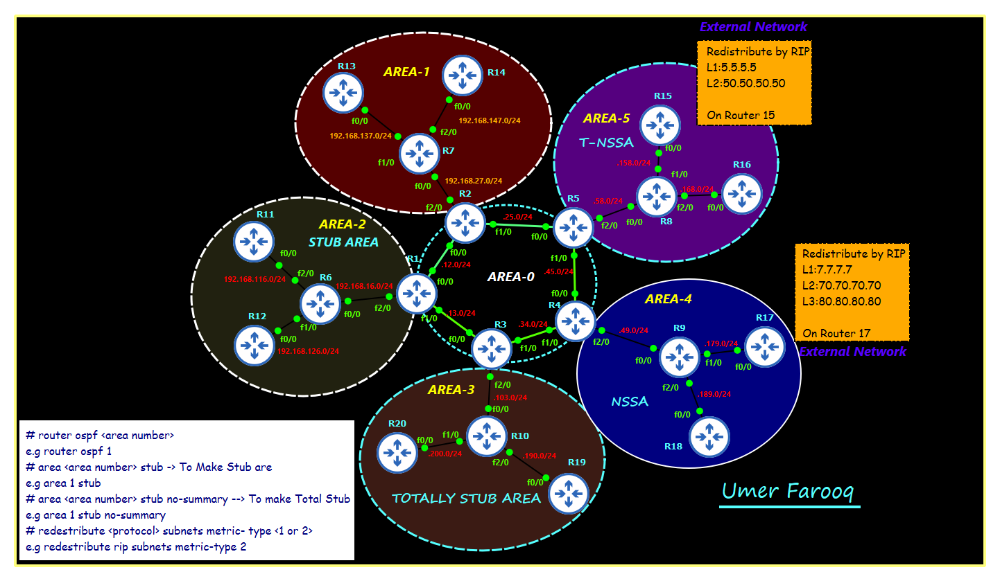

# Multi-Area OSPF Lab | Stub, Totally Stub, NSSA & Redistribution

Hands-on multi-area OSPF topology designed to demonstrate different OSPF area types, LSA filtering behavior, and route redistribution from RIP into OSPF.

This lab was implemented on Cisco IOS routers (GNS3) and covers:

- Multi-area OSPF hierarchical design
- Stub Area
- Totally Stub Area
- NSSA (Not-So-Stubby Area)
- External route injection via redistribution
- Metric-type control (E1)

---
## Topology



## Topology Overview

```
                        ┌─────────────────┐
                        │     AREA-1      │
                        │  (Regular Area) │
                        │  R13 ─ R7 ─ R14 │
                        └────────┬────────┘
                                 │
┌─────────────────┐     ┌────────┴────────┐     ┌─────────────────┐
│     AREA-2      │     │                 │     │     AREA-5      │
│   (Stub Area)   │     │     AREA-0      │     │     (NSSA)      │
│ R11 ─ R6 ─ R12  │─────│  R1 ─ R2 ─ R5   │─────│ R15 ─ R8 ─ R16  │
└─────────────────┘     │       │         │     └─────────────────┘
                        │  R3 ─ R4        │              ▲
                        └────────┬────────┘              │
                                 │              Redistribute RIP
┌─────────────────┐     ┌────────┴────────┐     (5.5.5.5 / 50.50.50.50)
│     AREA-3      │     │     AREA-4      │
│ (Totally Stub)  │─────│     (NSSA)      │
│ R20 ─ R10 ─ R19 │     │ R17 ─ R9 ─ R18  │
└─────────────────┘     └─────────────────┘
                                 ▲
                        Redistribute RIP
                   (7.7.7.7 / 70.70.70.70 / 80.80.80.80)
```

### Area Summary

| Area   | Type              | ABR(s)     | Key Behavior                                      |
|--------|-------------------|------------|---------------------------------------------------|
| 0      | Backbone          | -          | Transit area for inter-area traffic               |
| 1      | Regular           | R2         | Full LSA flooding (Type 1–5)                      |
| 2      | Stub              | R1         | Blocks Type-5 external LSAs                       |
| 3      | Totally Stub      | R3         | Blocks Type-3, Type-4 & Type-5 (default route only) |
| 4      | NSSA              | R4         | Allows Type-7 LSAs, converts to Type-5 at ABR     |
| 5      | NSSA              | R5         | Allows Type-7 LSAs, converts to Type-5 at ABR     |

---

## IP Addressing Table

### Backbone (AREA 0) Links

| Link              | Network          | R1          | R2          | R3          | R4          | R5          |
|-------------------|------------------|-------------|-------------|-------------|-------------|-------------|
| R1 ↔ R2           | 192.168.12.0/24  | .1          | .2          | -           | -           | -           |
| R1 ↔ R3           | 192.168.13.0/24  | .1          | -           | .3          | -           | -           |
| R2 ↔ R5           | 192.168.25.0/24  | -           | .2          | -           | -           | .5          |
| R3 ↔ R4           | 192.168.34.0/24  | -           | -           | .3          | .4          | -           |
| R4 ↔ R5           | 192.168.45.0/24  | -           | -           | -           | .4          | .5          |

### AREA 1 (Regular)

| Link / Device     | Network            | IP Address       |
|-------------------|--------------------|------------------|
| R2 ↔ R7           | 192.168.27.0/24    | R2: .2 / R7: .7  |
| R7 ↔ R13          | 192.168.137.0/24   | R7: .7 / R13: .13|
| R7 ↔ R14          | 192.168.147.0/24   | R7: .7 / R14: .14|

### AREA 2 (Stub)

| Link / Device     | Network            | IP Address       |
|-------------------|--------------------|------------------|
| R1 ↔ R6           | 192.168.16.0/24    | R1: .1 / R6: .6  |
| R6 ↔ R11          | 192.168.116.0/24   | R6: .6 / R11: .11|
| R6 ↔ R12          | 192.168.126.0/24   | R6: .6 / R12: .12|

### AREA 3 (Totally Stub)

| Link / Device     | Network            | IP Address        |
|-------------------|--------------------|-------------------|
| R3 ↔ R10          | 192.168.103.0/24   | R3: .3 / R10: .10 |
| R10 ↔ R19         | 192.168.190.0/24   | R10: .10 / R19: .19 |
| R10 ↔ R20         | 192.168.200.0/24   | R10: .10 / R20: .20 |

### AREA 4 (NSSA)

| Link / Device     | Network            | IP Address        |
|-------------------|--------------------|-------------------|
| R4 ↔ R9           | 192.168.49.0/24    | R4: .4 / R9: .9   |
| R9 ↔ R17          | 192.168.179.0/24   | R9: .9 / R17: .17 |
| R9 ↔ R18          | 192.168.189.0/24   | R9: .9 / R18: .18 |

### AREA 5 (NSSA)

| Link / Device     | Network            | IP Address        |
|-------------------|--------------------|-------------------|
| R5 ↔ R8           | 192.168.58.0/24    | R5: .5 / R8: .8   |
| R8 ↔ R15          | 192.168.158.0/24   | R8: .8 / R15: .15 |
| R8 ↔ R16          | 192.168.168.0/24   | R8: .8 / R16: .16 |

### External Networks (Redistributed via RIP)

| Router | Loopback          | Network         | Purpose                  |
|--------|-------------------|-----------------|--------------------------|
| R15    | Loopback1         | 5.5.5.5/24      | External prefix (E1)     |
| R15    | Loopback2         | 50.50.50.50/24  | External prefix (E1)     |
| R17    | Loopback1         | 7.7.7.7/24      | External prefix (E1)     |
| R17    | Loopback2         | 70.70.70.70/24  | External prefix (E1)     |
| R17    | Loopback3         | 80.80.80.80/24  | External prefix (E1)     |

### Router IDs

| Router | Router-ID   | Router | Router-ID    |
|--------|-------------|--------|--------------|
| R1     | 1.1.1.1     | R11    | 1.1.11.11    |
| R2     | 1.1.2.2     | R12    | 1.1.12.12    |
| R3     | 1.1.3.3     | R13    | 1.1.13.13    |
| R4     | 1.1.4.4     | R14    | 1.1.14.14    |
| R5     | 1.1.5.5     | R15    | 1.1.15.15    |
| R6     | 1.1.6.6     | R16    | 1.1.16.16    |
| R7     | 1.1.7.7     | R17    | 1.1.17.17    |
| R8     | 1.1.8.8     | R18    | 1.1.18.18    |
| R9     | 1.1.9.9     | R19    | 1.1.19.19    |
| R10    | 1.1.10.10   | R20    | 1.1.20.20    |

---

## Configuration Notes

### Special Area Commands Used

```cisco
! Stub Area (AREA 2)
area 2 stub

! Totally Stub Area (AREA 3) – applied on ABR (R3)
area 3 stub no-summary

! NSSA (AREA 4 & AREA 5)
area 4 nssa
area 4 nssa default-information-originate   ! on ABR R4
area 5 nssa
```

### Redistribution (External Routes)

```cisco
! On R15 (AREA 5 NSSA)
router ospf 1
 redistribute rip metric-type 1 subnets

router rip
 version 2
 network 5.0.0.0
 network 50.0.0.0
 no auto-summary

! On R17 (AREA 4 NSSA)
router ospf 1
 redistribute rip metric-type 1 subnets

router rip
 version 2
 network 7.0.0.0
 network 70.0.0.0
 network 80.0.0.0
 no auto-summary
```

> **Note:** `metric-type 1` generates E1 routes (cost is cumulative).  
> Change to `metric-type 2` for E2 routes (default, cost remains constant).

---

## Router Configurations

### R1 (ABR – AREA 0 / AREA 2 Stub)

```cisco
hostname R1
!
interface FastEthernet0/0
 ip address 192.168.12.1 255.255.255.0
!
interface FastEthernet1/0
 ip address 192.168.13.1 255.255.255.0
!
interface FastEthernet2/0
 ip address 192.168.16.1 255.255.255.0
!
router ospf 1
 router-id 1.1.1.1
 log-adjacency-changes
 area 2 stub
 network 192.168.12.0 0.0.0.255 area 0
 network 192.168.13.0 0.0.0.255 area 0
 network 192.168.16.0 0.0.0.255 area 2
```

### R2 (ABR – AREA 0 / AREA 1)

```cisco
hostname R2
!
interface FastEthernet0/0
 ip address 192.168.12.2 255.255.255.0
!
interface FastEthernet1/0
 ip address 192.168.25.2 255.255.255.0
!
interface FastEthernet2/0
 ip address 192.168.27.2 255.255.255.0
!
router ospf 1
 router-id 1.1.2.2
 log-adjacency-changes
 network 192.168.12.0 0.0.0.255 area 0
 network 192.168.25.0 0.0.0.255 area 0
 network 192.168.27.0 0.0.0.255 area 1
```

### R3 (ABR – AREA 0 / AREA 3 Totally Stub)

```cisco
hostname R3
!
interface FastEthernet0/0
 ip address 192.168.13.3 255.255.255.0
!
interface FastEthernet1/0
 ip address 192.168.34.3 255.255.255.0
!
interface FastEthernet2/0
 ip address 192.168.103.3 255.255.255.0
!
router ospf 1
 router-id 1.1.3.3
 log-adjacency-changes
 area 3 stub no-summary
 network 192.168.13.0 0.0.0.255 area 0
 network 192.168.34.0 0.0.0.255 area 0
 network 192.168.103.0 0.0.0.255 area 3
```

### R4 (ABR – AREA 0 / AREA 4 NSSA)

```cisco
hostname R4
!
interface FastEthernet0/0
 ip address 192.168.45.4 255.255.255.0
!
interface FastEthernet1/0
 ip address 192.168.34.4 255.255.255.0
!
interface FastEthernet2/0
 ip address 192.168.49.4 255.255.255.0
!
router ospf 1
 router-id 1.1.4.4
 log-adjacency-changes
 area 4 nssa default-information-originate
 network 192.168.34.0 0.0.0.255 area 0
 network 192.168.45.0 0.0.0.255 area 0
 network 192.168.49.0 0.0.0.255 area 4
```

### R5 (ABR – AREA 0 / AREA 5 NSSA)

```cisco
hostname R5
!
interface FastEthernet0/0
 ip address 192.168.25.5 255.255.255.0
!
interface FastEthernet1/0
 ip address 192.168.45.5 255.255.255.0
!
interface FastEthernet2/0
 ip address 192.168.58.5 255.255.255.0
!
router ospf 1
 router-id 1.1.5.5
 log-adjacency-changes
 network 192.168.25.0 0.0.0.255 area 0
 network 192.168.45.0 0.0.0.255 area 0
 network 192.168.58.0 0.0.0.255 area 5
```

> **Recommendation:** Add `area 5 nssa` on R5 for consistency with internal routers.

### R6 (AREA 2 Stub Internal)

```cisco
hostname R6
!
interface FastEthernet0/0
 ip address 192.168.16.6 255.255.255.0
!
interface FastEthernet1/0
 ip address 192.168.126.6 255.255.255.0
!
interface FastEthernet2/0
 ip address 192.168.116.6 255.255.255.0
!
router ospf 1
 router-id 1.1.6.6
 log-adjacency-changes
 area 2 stub
 network 192.168.16.0 0.0.0.255 area 2
 network 192.168.116.0 0.0.0.255 area 2
 network 192.168.126.0 0.0.0.255 area 2
```

### R7 (AREA 1 Internal)

```cisco
hostname R7
!
interface FastEthernet0/0
 ip address 192.168.27.7 255.255.255.0
!
interface FastEthernet1/0
 ip address 192.168.137.7 255.255.255.0
!
interface FastEthernet2/0
 ip address 192.168.147.7 255.255.255.0
!
router ospf 1
 router-id 1.1.7.7
 log-adjacency-changes
 network 192.168.27.0 0.0.0.255 area 1
 network 192.168.137.0 0.0.0.255 area 1
 network 192.168.147.0 0.0.0.255 area 1
```

### R8 (AREA 5 NSSA Internal)

```cisco
hostname R8
!
interface FastEthernet0/0
 ip address 192.168.58.8 255.255.255.0
!
interface FastEthernet1/0
 ip address 192.168.158.8 255.255.255.0
!
interface FastEthernet2/0
 ip address 192.168.168.8 255.255.255.0
!
router ospf 1
 router-id 1.1.8.8
 log-adjacency-changes
 area 5 nssa
 network 192.168.58.0 0.0.0.255 area 5
 network 192.168.158.0 0.0.0.255 area 5
 network 192.168.168.0 0.0.0.255 area 5
```

### R9 (AREA 4 NSSA Internal)

```cisco
hostname R9
!
interface FastEthernet0/0
 ip address 192.168.49.9 255.255.255.0
!
interface FastEthernet1/0
 ip address 192.168.179.9 255.255.255.0
!
interface FastEthernet2/0
 ip address 192.168.189.9 255.255.255.0
!
router ospf 1
 router-id 1.1.9.9
 log-adjacency-changes
 area 4 nssa
 network 192.168.49.0 0.0.0.255 area 4
 network 192.168.179.0 0.0.0.255 area 4
 network 192.168.189.0 0.0.0.255 area 4
```

### R10 (AREA 3 Totally Stub Internal)

```cisco
hostname R10
!
interface FastEthernet0/0
 ip address 192.168.103.10 255.255.255.0
!
interface FastEthernet1/0
 ip address 192.168.200.10 255.255.255.0
!
interface FastEthernet2/0
 ip address 192.168.190.10 255.255.255.0
!
router ospf 1
 router-id 1.1.10.10
 log-adjacency-changes
 area 3 stub
 network 192.168.103.0 0.0.0.255 area 3
 network 192.168.190.0 0.0.0.255 area 3
 network 192.168.200.0 0.0.0.255 area 3
```

### R11 (AREA 2 Stub)

```cisco
hostname R11
!
interface FastEthernet0/0
 ip address 192.168.116.11 255.255.255.0
!
router ospf 1
 router-id 1.1.11.11
 log-adjacency-changes
 area 2 stub
 network 192.168.116.0 0.0.0.255 area 2
```

### R12 (AREA 2 Stub)

```cisco
hostname R12
!
interface FastEthernet0/0
 ip address 192.168.126.12 255.255.255.0
!
router ospf 1
 router-id 1.1.12.12
 log-adjacency-changes
 area 2 stub
 network 192.168.126.0 0.0.0.255 area 2
```

### R13 (AREA 1)

```cisco
hostname R13
!
interface FastEthernet0/0
 ip address 192.168.137.13 255.255.255.0
!
router ospf 1
 router-id 1.1.13.13
 log-adjacency-changes
 network 192.168.137.0 0.0.0.255 area 1
```

### R14 (AREA 1)

```cisco
hostname R14
!
interface FastEthernet0/0
 ip address 192.168.147.14 255.255.255.0
!
router ospf 1
 router-id 1.1.14.14
 log-adjacency-changes
 network 192.168.147.0 0.0.0.255 area 1
```

### R15 (AREA 5 NSSA + Redistribution)

```cisco
hostname R15
!
interface Loopback1
 ip address 5.5.5.5 255.255.255.0
!
interface Loopback2
 ip address 50.50.50.50 255.255.255.0
!
interface FastEthernet0/0
 ip address 192.168.158.15 255.255.255.0
!
router ospf 1
 router-id 1.1.15.15
 log-adjacency-changes
 area 5 nssa
 redistribute rip metric-type 1 subnets
 network 192.168.158.0 0.0.0.255 area 5
!
router rip
 version 2
 network 5.0.0.0
 network 50.0.0.0
 no auto-summary
```

### R16 (AREA 5 NSSA)

```cisco
hostname R16
!
interface FastEthernet0/0
 ip address 192.168.168.16 255.255.255.0
!
router ospf 1
 router-id 1.1.16.16
 log-adjacency-changes
 area 5 nssa
 network 192.168.168.0 0.0.0.255 area 5
```

### R17 (AREA 4 NSSA + Redistribution)

```cisco
hostname R17
!
interface Loopback1
 ip address 7.7.7.7 255.255.255.0
!
interface Loopback2
 ip address 70.70.70.70 255.255.255.0
!
interface Loopback3
 ip address 80.80.80.80 255.255.255.0
!
interface FastEthernet0/0
 ip address 192.168.179.17 255.255.255.0
!
router ospf 1
 router-id 1.1.17.17
 log-adjacency-changes
 area 4 nssa
 redistribute rip metric-type 1 subnets
 network 192.168.179.0 0.0.0.255 area 4
!
router rip
 version 2
 network 7.0.0.0
 network 70.0.0.0
 network 80.0.0.0
 no auto-summary
```

### R18 (AREA 4 NSSA)

```cisco
hostname R18
!
interface FastEthernet0/0
 ip address 192.168.189.18 255.255.255.0
!
router ospf 1
 router-id 1.1.18.18
 log-adjacency-changes
 area 4 nssa
 network 192.168.189.0 0.0.0.255 area 4
```

### R19 (AREA 3 Totally Stub)

```cisco
hostname R19
!
interface FastEthernet0/0
 ip address 192.168.190.19 255.255.255.0
!
router ospf 1
 router-id 1.1.19.19
 log-adjacency-changes
 area 3 stub
 network 192.168.190.0 0.0.0.255 area 3
```

### R20 (AREA 3 Totally Stub)

```cisco
hostname R20
!
interface FastEthernet0/0
 ip address 192.168.200.20 255.255.255.0
!
router ospf 1
 router-id 1.1.20.20
 log-adjacency-changes
 area 3 stub
 network 192.168.200.0 0.0.0.255 area 3
```

---

## Verification Commands

### Basic OSPF Verification

```cisco
show ip ospf
show ip ospf neighbor
show ip ospf interface brief
show ip ospf database
show ip route ospf
show ip route
```

### Area-Type Specific Checks

```cisco
! Check area type and flags
show ip ospf | include Area

! View LSA types present in the database
show ip ospf database

! Filter for specific LSA types
show ip ospf database router
show ip ospf database network
show ip ospf database summary
show ip ospf database asbr-summary
show ip ospf database external
show ip ospf database nssa-external
```

### Stub / Totally Stub Verification

```cisco
! On internal routers in AREA 2 (Stub) – should NOT see external routes (O E1/E2)
show ip route | include E1|E2

! On internal routers in AREA 3 (Totally Stub) – should only see a default route
show ip route
! Expected: O*IA 0.0.0.0/0 via ABR
```

### NSSA Verification

```cisco
! On NSSA internal routers – look for Type-7 LSAs
show ip ospf database nssa-external

! On ABR (R4 / R5) – Type-7 should be converted to Type-5
show ip ospf database external

! Verify redistributed routes appear as O N1 / O N2 inside NSSA
show ip route | include N1|N2
```

### Redistribution Verification

```cisco
! On R15 and R17
show ip protocols
show ip route rip
show ip ospf database nssa-external self-originate

! From backbone or other areas – external routes should appear as O E1
show ip route | include 5.5.5.5|50.50.50.50|7.7.7.7|70.70.70.70|80.80.80.80
```

### Connectivity Tests

```cisco
! From a Stub internal router (e.g. R11)
ping 192.168.147.14          ! AREA 1
ping 192.168.190.19          ! AREA 3
ping 5.5.5.5                 ! External (should fail or go via default depending on area)

! From Totally Stub internal (R20)
ping 192.168.12.1            ! Backbone
show ip route                ! Confirm only default route + intra-area routes
```

---

## Expected Behavior Summary

| Source Area       | Sees Intra-Area | Sees Inter-Area (Type-3) | Sees External (Type-5) | Sees Type-7 |
|-------------------|-----------------|---------------------------|------------------------|-------------|
| AREA 0 (Backbone) | Yes             | Yes                       | Yes (E1)               | No          |
| AREA 1 (Regular)  | Yes             | Yes                       | Yes (E1)               | No          |
| AREA 2 (Stub)     | Yes             | Yes                       | No                     | No          |
| AREA 3 (Tot Stub) | Yes             | No (default only)         | No                     | No          |
| AREA 4 (NSSA)     | Yes             | Yes*                      | No (Type-7 instead)    | Yes (N1)    |
| AREA 5 (NSSA)     | Yes             | Yes*                      | No (Type-7 instead)    | Yes (N1)    |

\* With `default-information-originate` on the ABR, a default route is injected into the NSSA.

---

## Key Learning Points

1. **Stub Area** prevents external routes (Type-5) from entering the area → reduces LSDB size.
2. **Totally Stub Area** goes further and also blocks inter-area summaries (Type-3) → only a default route is injected by the ABR.
3. **NSSA** allows external routes to be injected *inside* the area as Type-7 LSAs. The ABR translates Type-7 → Type-5 so the rest of the OSPF domain can see them.
4. **metric-type 1** (E1/N1) makes the external cost cumulative. **metric-type 2** (E2/N2) keeps the cost constant.
5. All routers in a special area (including the ABR) must agree on the area type configuration, otherwise adjacency will fail.

---

## How to Use This Lab

1. Build the topology in GNS3 / EVE-NG using Cisco IOS routers.
2. Apply the configurations above (or load the provided configs).
3. Verify adjacencies and area types.
4. Inject the external prefixes on R15 and R17.
5. Observe LSA types and routing tables in each area type.
6. Experiment by changing `metric-type`, adding `no-summary` on NSSA ABRs, etc.

---

**Author:** Umer Farooq  
**Lab Focus:** Multi-Area OSPF, Special Areas & Redistribution  
**Platform:** Cisco IOS (GNS3 / EVE-NG)

---

#Networking #OSPF #Cisco #CCNP #RoutingAndSwitching #NetworkEngineering #GNS3 #EVE-NG #StubArea #NSSA #RouteRedistribution

---

Umer Farooq · Networking labs (CCNP routing track) | OSPF Multi-Area, Stub, NSSA & Route Redistribution
